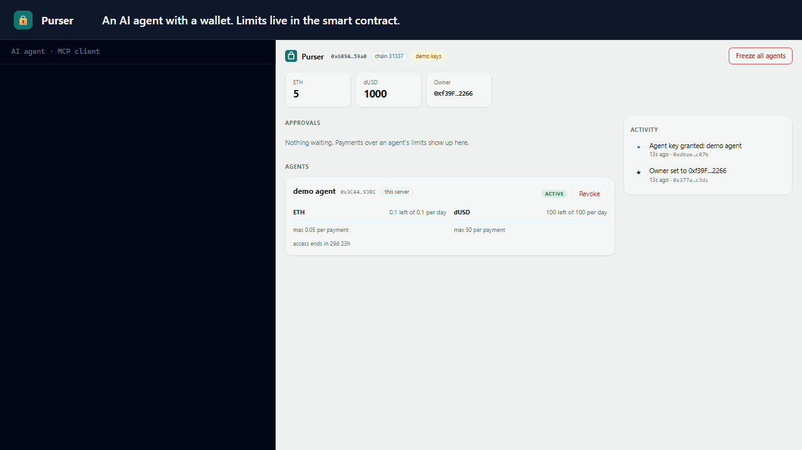
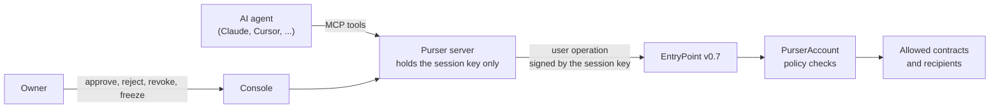

# Purser

[](https://github.com/ahmad-codex/purser/actions/workflows/ci.yml)
[](./LICENSE)
[](./contracts)
[](https://eips.ethereum.org/EIPS/eip-4337)
[](https://modelcontextprotocol.io/)

Give an AI agent a wallet without giving it your keys.

Purser is an ERC-4337 smart account where each agent gets its own session key with a
policy: which contracts and functions it may call, how much it may spend per payment and per day,
and until when. Payments inside the policy go through on their own. Anything over the limits
waits for you to approve. An MCP server lets Claude, Cursor or any MCP client use the wallet, and
a console shows budgets, spending and pending approvals as they happen.



## Why

Agents are starting to pay for things: API credits, compute, data, subscriptions. Today that
usually means one of two bad options:

- **Hand the agent a private key.** One prompt injection or bug away from an empty wallet.
- **Approve every payment by hand.** Safe, and it defeats the point of an agent.

Purser sits in between. The limits live in the contract, so they hold even if the agent,
the server it runs on, or its key is compromised. The worst a leaked agent key can do is spend the
rest of the current budget at allowed places, and burn some ETH on gas, until you revoke it or
freeze the account, which takes one transaction. (A gas budget per key is on the
[roadmap](./ROADMAP.md).)

## What's inside

| Layer | What it shows |
|---|---|
| Smart contracts | ERC-4337 v0.7 account with session keys, allow-lists, per-transaction caps and rolling budgets; owner co-signature for over-limit operations; UUPS upgrades, ERC-1271, CREATE2 factory with the same address on every chain |
| Protocol rules | Validation that follows ERC-7562 (no clock reads), so public bundlers accept it; time-based budgets moved to the execution phase through `executeUserOp` |
| Testing | 41 unit tests through a real EntryPoint, fuzz tests against a budget model, invariant tests with a stateful handler, gas snapshot, Slither in CI |
| TypeScript SDK | viem client that builds, signs and submits user operations through a bundler or `handleOps`, decodes policy errors, and indexes events within public RPC log limits |
| AI integration | MCP server (streamable HTTP and stdio) with six tools, model-readable refusals, and a human-in-the-loop approval flow |
| Product | React console with budget meters, live activity, approvals, revoke and a kill switch |
| Delivery | One-command demo image, Docker Compose, CI that plays the full story end to end, testnet deploy script |

## How it works



1. The owner grants an agent a **session key** with a policy: an allow-list of `(contract,
   function)` pairs, a per-transaction cap and a per-period budget for each token (ETH or ERC-20),
   and a validity window.
2. The agent calls MCP tools such as `send_eth` or `call_contract`. The server dry-runs the call
   against the policy, signs a user operation with the session key and submits it.
3. The account checks the signature, the window, the allow-list and the per-transaction caps
   **during validation**, so a disallowed operation fails before it costs anything. Budgets need
   the block time, which ERC-4337 forbids in validation, so they are enforced in `executeUserOp`.
4. Over the limit? The server turns it into an **approval request**. When the owner approves, the
   operation carries both the session signature and the owner's signature, and it runs without
   using the agent's budget. An approval raises the amount, never the scope: the allow-list still
   applies.
5. The owner can revoke a key or **freeze** the whole account at any time. A revoke or freeze
   earlier in the same bundle still stops a later agent operation.

## Try it in one command

You need Docker. Nothing to clone, nothing to install:

```bash
docker run --rm -it -p 127.0.0.1:8787:8787 ghcr.io/ahmad-codex/purser:demo
```

The container starts a local chain, deploys the EntryPoint, the factory and a fresh account with a
seeded agent, and starts the MCP server and the console. Open http://localhost:8787 and watch:
ten seconds later the agent story plays in the terminal while the console updates live.

The agent pays a merchant, pays in a token, buys from a shop contract, tries a payment over the
limit (the approval request appears in the console), gets approved, is refused for a recipient
that is not on its allow-list, and is stopped by the kill switch. Then the wallet stays up for
your own agent. Everything uses Anvil's public development keys and is gone when you press Ctrl+C.

From a clone, `docker compose up` runs the same stack as separate services, and
`docker compose run --rm demo` plays the story against it.

### Connect your own agent

With the demo running, point any MCP client at `http://localhost:8787/mcp`:

```bash
claude mcp add --transport http purser http://localhost:8787/mcp
```

Then ask Claude: *"Check the wallet status, then pay the merchant 0.01 ETH for API credits."*
Try *"pay the merchant 0.3 ETH"* to see an approval request show up in the console.
[docs/mcp-clients.md](./docs/mcp-clients.md) covers Claude Desktop, Cursor and stdio.

## MCP tools

| Tool | What it does |
|---|---|
| `wallet_status` | Balances, the agent's remaining budget per token, caps, reset times, expiry, freeze state, pending approvals |
| `send_eth` | Pay ETH to an address or a known name |
| `send_token` | Pay ERC-20 tokens by symbol or address |
| `call_contract` | Call an allowed contract function, optionally with ETH, e.g. `buy(uint256)` |
| `get_request` | Status of an approval request |
| `list_requests` | Recent approval requests |

Each payment tool returns one of: done (with the transaction hash and the budget left), waiting for
the owner (with the request id), or refused (with a reason the model can act on).

## The policy

| Field | Meaning |
|---|---|
| `permissions` | `(target, selector)` pairs. `0xffffffff` allows any function on a target; `0x00000000` allows plain ETH transfers. The account itself can never be a target. |
| `limits` | Per token (`address(0)` is ETH): `perTx` cap and `perPeriod` budget. ERC-20 `transfer`, `approve` and `transferFrom` from the account count as spending. |
| `period` | Budget window in seconds, for example `86400` for a daily budget. |
| `validAfter`, `validUntil` | When the key works. Enforced by the EntryPoint through the validation data. |

Granting a key again replaces its whole policy; old permissions do not leak into the new one.

## Contracts

| Contract | Purpose |
|---|---|
| [`PurserAccount`](./contracts/src/PurserAccount.sol) | The account: ERC-4337 v0.7, UUPS upgradeable by its owner, ERC-1271, token callbacks |
| [`PurserFactory`](./contracts/src/PurserFactory.sol) | CREATE2 factory, so an account's address is known before it is deployed |

Built on the [eth-infinitism](https://github.com/eth-infinitism/account-abstraction) reference
EntryPoint v0.7 and OpenZeppelin 5. The factory deploys through the deterministic CREATE2 proxy,
so it has the same address on every chain with the canonical EntryPoint.

**Tests.** 41 unit tests through a real EntryPoint, fuzz tests that check random payment and time
sequences against a model of the budget, and invariant tests (about 16,000 random calls per run)
for three properties: an agent never spends more than its budget per period without approval, a
revoked key never moves funds again, and the policy never changes behind the owner's back. Slither
runs in CI. See [docs/security.md](./docs/security.md) for the threat model.

**Deployments.** See [docs/deployments.md](./docs/deployments.md).

## Repository layout

```
contracts/        Foundry project: PurserAccount, factory, tests, deploy and demo scripts
packages/sdk/     TypeScript client on viem: build, sign and send user operations, read state
packages/server/  MCP server (HTTP and stdio), approvals API, serves the console
apps/console/     React console for the owner
scripts/          local-up.sh, deploy-testnet.sh, demo.ts, demo-entrypoint.sh
Dockerfile.demo   all-in-one demo image (chain, contracts, server, console)
docs/             architecture, security, MCP clients, deployments
```

## Development

```bash
npm install
cd contracts && forge test          # unit, fuzz and invariant tests
cd .. && npm test                   # TypeScript unit tests
./scripts/local-up.sh               # Anvil + deploy + demo account, writes .env.local
npm run build -w @purser/console
npm run server                      # console and MCP on http://localhost:8787
npm run demo                        # the end-to-end story; CI runs it too
```

No Foundry installed? `contracts/forge.sh forge test` runs it from the official Docker image, and
`scripts/local-up.sh` falls back to Docker on its own.

To deploy to Base Sepolia or Sepolia, see [docs/deployments.md](./docs/deployments.md): one script,
and a faucet drip of under 0.01 ETH covers everything.

## Status

Early, version 0.1.1. Not audited. Use testnets, and do not put real funds in an account you have
not reviewed yourself. What is planned next is in [ROADMAP.md](./ROADMAP.md), and issues labelled
`good first issue` are a good place to start contributing.

## Contributing

See [CONTRIBUTING.md](./CONTRIBUTING.md). Security reports go through
[private advisories](https://github.com/ahmad-codex/purser/security/advisories/new), not
issues.

## License

[MIT](./LICENSE)
